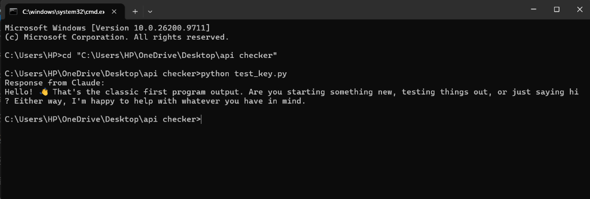

# Anthropic Claude API Key Checker

A simple Python utility to test whether an Anthropic API key is valid and working by sending a minimal test request to Claude.



---

## Prerequisites

Before starting, ensure you have:
1. Python 3.10 or higher installed on your computer.
2. A terminal (Command Prompt, PowerShell, or macOS/Linux terminal).
3. An Anthropic API key from console.anthropic.com.

---

## Step 1: Download the Project

Clone the repository using Git:

```bash
git clone https://github.com/your-username/api-checker.git
cd api-checker
```

If you downloaded the code as a ZIP file, extract it and navigate into the folder:

```cmd
cd "C:\Users\YourUsername\path\to\api checker"
```

---

## Step 2: Install Required Dependencies

The script uses the official Anthropic Python library. Install it using pip:

```cmd
pip install anthropic
```

Or install from the requirements file:

```cmd
pip install -r requirements.txt
```

---

## Step 3: Run the Verification Script

You have two ways to run the test:

### Option A: Interactive Prompt (Easiest)

Run the script directly without arguments:

```cmd
python test_key.py
```

If no API key is detected, the terminal will prompt you:

```text
Enter your Anthropic API Key:
```

Paste your key and press Enter. The script will send a test message ("Hello, world") to Claude and print the response.

### Option B: Set an Environment Variable (Recommended for Security)

Setting an environment variable prevents your key from being typed out or saved in shell history.

On Windows (PowerShell):
```powershell
$env:ANTHROPIC_API_KEY="your-api-key-here"
python test_key.py
```

On Windows (Command Prompt):
```cmd
set ANTHROPIC_API_KEY=your-api-key-here
python test_key.py
```

On Linux or macOS:
```bash
export ANTHROPIC_API_KEY="your-api-key-here"
python test_key.py
```

---

## Step 4: Verify the Output

When your key is valid and active, Claude will return a text response:

```text
Response from Claude:
Hello! That's the classic first program output. Are you starting something new, testing things out, or just saying hi? Either way, I'm happy to help with whatever you have in mind.
```

If the key is invalid or expired, you will receive an authentication error from Anthropic indicating that the key was rejected.

---

## Advanced: Full API Checker Tool

The repository also includes `api_checker.py`, which provides more detailed diagnostics:
- Validates the key.
- Measures network latency in milliseconds.
- Lists all models accessible on your account.
- Tests token generation.

To run it:

```cmd
python api_checker.py
```

---

## Security Notes

1. Never commit API keys to version control.
2. The included `.gitignore` file automatically excludes `.env` and text files containing keys.
3. If a key is ever accidentally exposed, revoke it immediately at console.anthropic.com.

---

## License

This project is licensed under the MIT License. See LICENSE for details.
